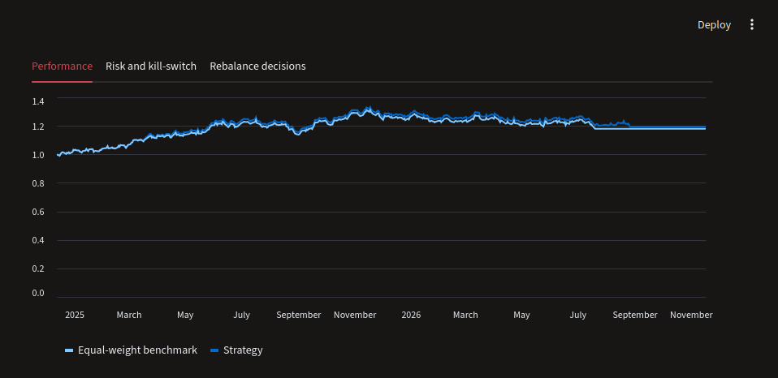
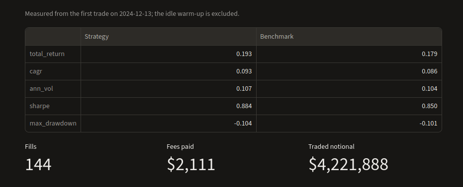
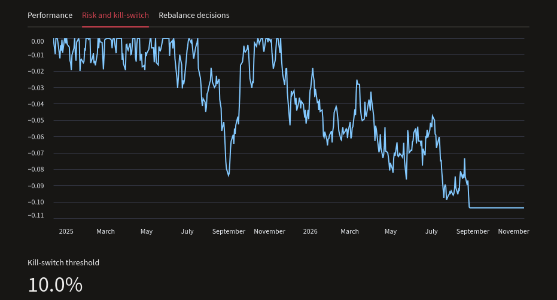
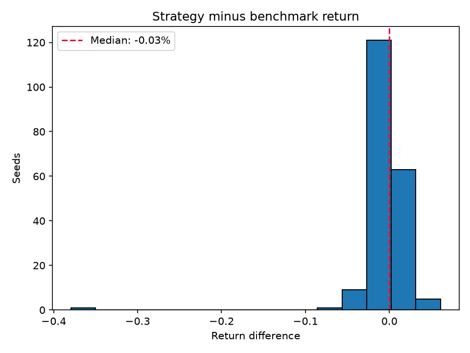
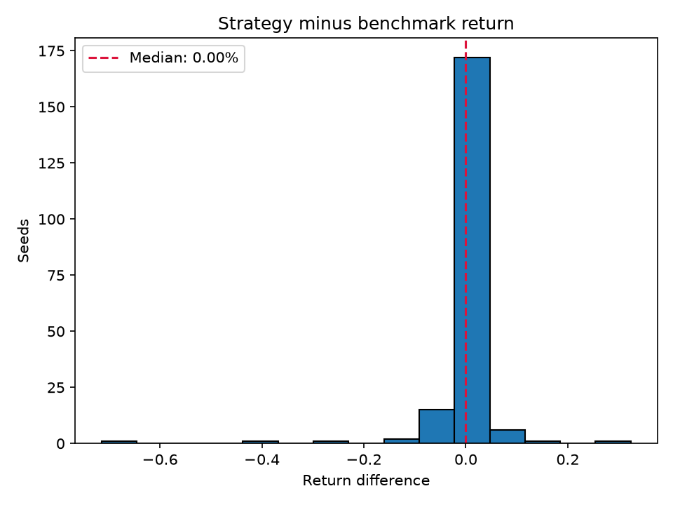

# Quant Stack

An educational **paper-trading research stack**: walk-forward portfolio optimization
([skfolio](https://github.com/skfolio/skfolio)) executed through an event-driven simulator
([NautilusTrader](https://github.com/nautechsystems/nautilus_trader)), with a confidence-weighted
forecast layer and hard risk limits.

> **Not financial advice. Paper/backtest only.** There is no live-trading mode (the config schema
> rejects `environment: live`). Nothing in this repository is evidence of a profitable strategy:
> the default demo runs on *synthetic random prices*, where no edge exists by construction.

## Architecture: four desks, one pipeline

```
 prices ─► 1. FORECAST ─► 2. PORTFOLIO ─► blend(confidence) ─► 3. EXECUTION ─► 4. OVERSIGHT
           forecasting/    optimization/   optimization/        trading/        risk.py +
           baseline.py     portfolio.py    blend.py             strategy.py     trading/strategy.py
```

| Desk | What it does | Where |
|---|---|---|
| Forecast | Expected return **with a standard error**; reduces to one confidence number in [0, 1]. Baseline = trailing mean and t-stat (swap in any model via the `Forecaster` protocol). | `forecasting/baseline.py` |
| Portfolio | Max-ratio mean-risk optimization (CVaR / CDaR / variance), denoised covariance, shrunk mean, sector limits, per-asset turnover cap, fallback chain. | `optimization/portfolio.py` |
| Blend | `w = benchmark + confidence * (optimized - benchmark)`. Confident: tilt hard. Guessing: snap back to equal weight. | `optimization/blend.py` |
| Execution | Rebalances to target weights as whole-share market orders; orders are sliced to respect `max_order_value`. | `trading/strategy.py` |
| Oversight | Drawdown kill-switch: cancel orders, flatten everything, halt (latched). Pure logic lives in `risk.py` and is unit-tested separately. | `risk.py` |

No LLM is anywhere in the order path.

## Quick start

Requires **Python 3.12+** (NautilusTrader does not support 3.11).

```bash
python -m venv .venv && source .venv/bin/activate      # Windows: .venv\Scripts\activate
pip install -e ".[dev]"

pytest                                                  # 56 tests, includes the engine cross-check
quant-stack backtest --config configs/paper_trading.yaml --engine both
quant-stack dashboard                                   # http://127.0.0.1:8501
```

Example output (synthetic data, so the numbers are meaningless as evidence):

```
Preset: paper_trading | environment: paper | data: synthetic
NOTE: synthetic (random) prices: results say nothing about real markets.
Period: 2021-08-06 -> 2024-06-28 (756 bars, 26 rebalance decisions)
Metrics measured from first trade: 2022-07-27 (warm-up excluded)
Strategy : return  19.33% | CAGR   9.28% | vol 10.69% | Sharpe  0.88 | maxDD -10.37%
Benchmark: return  17.92% | CAGR   8.62% | vol 10.36% | Sharpe  0.85 | maxDD -10.13%  (equal-weight, same rules and costs)
Fills: 144 | fees: $2,110.92 | traded: $4,221,888
Kill-switch: TRIPPED on 2024-04-09
Nautilus: final equity $1,193,340.32 | fills 144 | max |diff| vs reference simulator $0.03
```

Real prices: `pip install -e ".[yfinance]"` then `--provider yfinance`. Yahoo's terms restrict
commercial use, so treat it as a research source only.

Docker (not exercised in CI): `docker compose up --build` serves the dashboard on port 8501;
`docker compose --profile tools run --rm backtest` runs the CLI backtest.

## Screenshots

All screenshots use **synthetic random prices** (seed 42, `paper_trading` preset, 10% kill-switch), so the results say nothing about real markets. The benchmark is an equal-weight portfolio run through the same simulator as the strategy (same fees, order slicing and kill-switch), rebalanced on the same dates.








## What this does and doesn't do

**Does:**
- Optimizes portfolio weights (skfolio)
- Simulates execution (NautilusTrader)
- Applies fees and a drawdown kill-switch
- Compares against an equal-weight benchmark

**Doesn't:**
- Place live orders
- Use real market data by default
- Demonstrate a profitable strategy

## Seed sweep (synthetic data)

```bash
quant-stack sweep --preset aggressive_growth --seeds 200 --workers 2
quant-stack sweep --preset paper_trading --seeds 200 --workers 2
```

The sweep runs the same reference backtest on 200 different random price histories (seeds 0 to 199, fixed end date, so the same command always gives the same CSV) and compares the strategy with the equal-weight benchmark. It writes a CSV and a histogram to `results/`, and the printed summary splits the seeds by whether the kill-switch tripped for the strategy, the benchmark, both or neither. The plot needs matplotlib, which is part of the `dev` extra.

| | `aggressive_growth` (15% kill-switch) | `paper_trading` (10% kill-switch) |
|---|---|---|
| Mean difference (strategy minus benchmark) | -0.23% (95% CI -0.65% to +0.20%) | -0.43% (95% CI -1.38% to +0.53%) |
| Median difference | -0.03% | 0.00% |
| Strategy beats benchmark | 46.0% of seeds | 48.5% of seeds |
| Strategy hit the kill-switch | 13.5% of seeds | 74.0% of seeds |
| Neither tripped | 173 seeds, mean +0.06%, std 1.44 pts | 51 seeds, mean -0.42%, std 3.38 pts |
| Both tripped | 24 seeds, mean -0.27%, std 0.73 pts | 146 seeds, mean +0.08%, std 2.94 pts |
| Only the strategy tripped | 3 seeds, mean -16.38% | 2 seeds, mean -54.22% |
| Only the benchmark tripped | 0 seeds | 1 seed, +32.35% |
| Extra fees paid by the strategy per run | about $271 | about $651 |

- In both presets the confidence interval for the mean difference includes zero: there is no detectable difference between the optimizer's weights and equal weights on random prices.
- The kill-switch matters more than the optimizer. At the 10% limit the strategy trips in 74% of random histories, and once it trips it stays in cash for the rest of the run.
- The large gaps come from the few seeds where only one side trips. In `aggressive_growth` those were near-threshold cases: the strategy's drawdown crossed the 15% limit while the benchmark's stayed 0.02 to 1.1 points below it. The gaps go both ways, and there are too few of them to say either side is favoured. Setting those seeds aside, the mean difference is within 0.1 points of zero in both presets.




*Return difference per seed (strategy minus benchmark), as a fraction: -0.1 means the strategy finished 10 points behind. The isolated bars far from zero are the few seeds where only one side hit the kill-switch.*

These are results on synthetic random prices. They say nothing about real markets.

## How the engines are verified

`simulate()` (a fast reference simulator) and the NautilusTrader strategy implement the same rules:
decide at close *t*, trade at close *t + `execution_lag_bars`*, whole shares, fees on notional,
order slicing, drawdown kill-switch. `tests/test_nautilus_parity.py` asserts that they produce the
same equity curve (within $1 on $1,000,000), the same number of fills, the same final positions and
the same kill-switch date. If you change one engine, the test tells you when they diverge.

## Project layout

```
.github/workflows/ci.yml    ruff + full test suite on pushes to main and on pull requests
configs/                    YAML presets (validated by quant_stack/config.py)
docs/screenshots/           dashboard screenshots used in this README
results/                    seed-sweep output (CSVs are git-ignored, PNGs are kept)
src/quant_stack/
  config.py                 typed schema; unknown keys and live mode are rejected
  risk.py                   DrawdownMonitor, order slicing (pure Python)
  data/                     providers (synthetic, csv, yfinance), cache, cleaning
  forecasting/baseline.py   Forecast + Forecaster protocol
  optimization/             portfolio.py, blend.py, tuning.py (walk-forward grid search)
  backtest/                 schedule.py (walk-forward), simulate.py, metrics.py, runner.py,
                            sweep.py (seed sweeps)
  trading/                  strategy.py + engine.py (NautilusTrader)
  dashboard/app.py          Streamlit UI (shows only real simulation output)
  cli.py                    quant-stack backtest | dashboard | sweep
tests/                      unit, property, parity and smoke tests
```

## Configuration notes

* `max_weight_change` maps to skfolio's `max_turnover`, which is a **per-asset** cap on
  `|new weight - previous weight|`, not total portfolio turnover. It only has effect when previous
  weights are supplied; the walk-forward loop does this for you.
* Sector groups are passed to skfolio as `{asset: [sector]}`. The reverse mapping is silently
  ignored by the library, and a test guards against that regression.
* `cash_buffer` must exceed twice `fee_rate` (validated) so a rebalance can never overspend.

## Known limitations (read before trusting any number)

* **Close-to-close bars.** Bars are built from adjusted closes (O=H=L=C) and fills happen at the
  execution bar's close. There is no intraday path, spread or market impact, only a proportional fee.
* **Survivorship and selection bias.** Presets use today's well-known tickers.
* **Baseline forecaster is simple.** It estimates confidence from trailing t-statistics; it is a
  placeholder for a real model, not a source of alpha.
* **Warm-up is excluded from metrics.** The optimizer needs `train_window` days of history, so the
  first months hold only cash; CAGR/vol/Sharpe are measured from the first trade (same start for the
  benchmark).
* **Kill-switch latches** for the rest of a run (by design); restart to re-arm. In the seed sweep
  this makes a single trip decisive for a seed's result.
* **Data licensing.** yfinance is research-only. A commercial product needs licensed data.
* **License note.** This project is BSD-3-Clause; NautilusTrader is LGPL-3.0, so review its terms
  before redistributing a bundled or modified build.

## Roadmap ideas

1. Plug a real forecaster (e.g. a time-series foundation model) into the `Forecaster` protocol and
   evaluate it out-of-sample against the equal-weight benchmark.
2. Walk-forward report: per-period returns, turnover, cost drag, benchmark-relative statistics.
3. Paper-trading adapter for a broker sandbox behind the same strategy class.